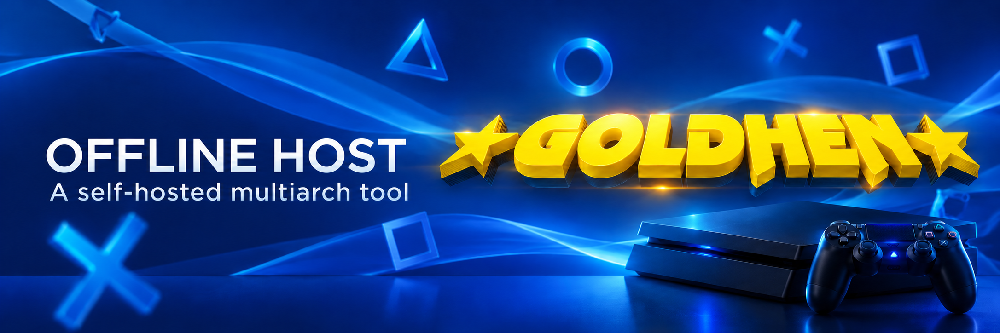
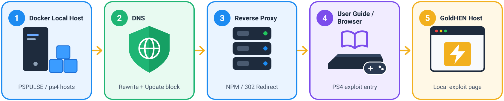
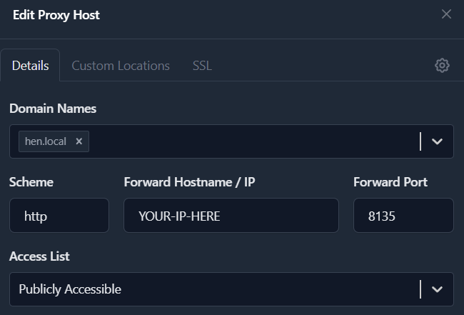
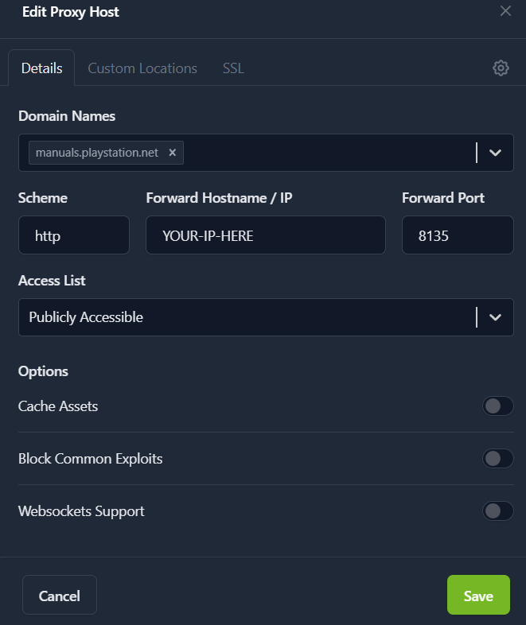
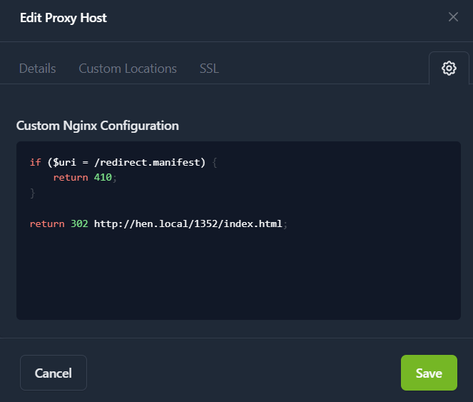

# Self-hosted PS4 Exploit Host for GoldHEN (Multi-Arch)

[](https://github.com/Chrisser73/ps4-host-offline-goldhen/pkgs/container/ps4-host-offline-goldhen)
[](LICENSE)
[](#step-4-configure-local-dns-adguard-example)
[](#step-5-configure-the-http-proxy-nginx-proxy-manager-example)

Run the [psx8 PSPulse PS4 exploit host](https://github.com/psx8/psx8.github.io) and its bundled GoldHEN payloads on your own home server or PC. This project packages the upstream site in a small multi-architecture Nginx image, then shows how to add a local PS4 update-domain block and open the right firmware page from the PS4 User Guide.

#### Workflow overview:


## Features

| | Feature | What it does |
| --- | --- | --- |
| 🏠 | Self-hosted PS4 payloads | Serve psx8's pages and GoldHEN on port `8135`. |
| 📴 | Offline-ready hosting | Serve the downloaded image locally without internet; downloads and updates need internet. |
| 💾 | Offline cache | Correct AppCache MIME type; test offline use on the PS4. |
| 🛡️ | Optional DNS rules | Block selected update domains for the PS4; not a guarantee against updates. |
| 📖 | Optional User Guide redirect | Open the firmware selector or a matching page through local DNS and an HTTP proxy. |
| 🐳 | Multi-arch | x86-64/AMD64 and ARM64 on a home server or PC, including Docker Desktop. |

## Step 1: Requirements

| Tool | Needed for | Official install guide |
| --- | --- | --- |
| Docker + Compose | **Required:** run the host | [Docker](https://docs.docker.com/get-started/get-docker/) · [Compose](https://docs.docker.com/compose/install/) |
| Git | **Optional:** clone the repository instead of copying `docker-compose.yml` | [Git](https://git-scm.com/install/) |
| Local DNS (AdGuard Home example) | **Optional:** PS4 User Guide shortcut / DNS rules | [AdGuard Home](https://adguard-dns.io/kb/adguard-home/getting-started/) |
| HTTP proxy (Nginx Proxy Manager example) | **Optional:** PS4 User Guide shortcut on port 80 | [Nginx Proxy Manager](https://nginxproxymanager.com/setup/) |

The image contains **Linux containers** for AMD64 and ARM64 hosts running Windows, macOS or Linux; on Windows, use Docker Desktop's Linux-container mode. Keep DNS/proxy access on your LAN.

Replace the examples: `hen.local` (your chosen LAN name), `<host-ip>` / `<ps4-ip>` (private LAN addresses), and `manuals.playstation.net` (verify the actual guide domain). Do not publish private IPs.

**Only need the browser host?** Complete Steps 2–3. Steps 4–8 are optional.

## Step 2: Start the Docker host

On your Docker host (home server or PC), **if Git is installed**:

```sh
git clone https://github.com/Chrisser73/ps4-host-offline-goldhen.git
cd ps4-host-offline-goldhen
docker compose up -d
docker compose ps
```

The image includes the web files; `www` is not needed. **Pull fails?** Check the GitHub image workflow and GHCR package visibility (or authenticate to GHCR).

In the **normal PS4 browser**, open:

| Page | URL |
| --- | --- |
| Home | `http://<host-ip>:8135/` |
| Firmware 13.52 | `http://<host-ip>:8135/1352/index.html` |

**Choose the page matching your firmware.** Test offline caching on the PS4; MIME type alone does not prove it works.

To check the manifest response:

```sh
curl -I http://<host-ip>:8135/1352/cache.manifest
```

## Step 3: Reserve IPs on your router

In your router, reserve LAN IPs for the **Docker/AdGuard host** (`<host-ip>`) and **PS4** (`<ps4-ip>`). DHCP reservations (“always assign the same IPv4 address”) are sufficient.

## Step 4: Configure local DNS (AdGuard example)

**Using another DNS provider to block updates?** Do not switch the PS4 DNS yet.

1. **Settings → Client settings:** add or edit a persistent client named `PS4`. Set **Identifier** to `<ps4-ip>`. If the router provides DHCP, identify it by IP, not MAC.
2. **If retaining an existing blocking DNS:** open this client's **Upstream DNS servers**, enable individual upstreams and enter that provider's address. Save. This upstream is **not needed** for the local host or User Guide redirect; keep it only if you still rely on its filtering. It will not resolve other domains while offline. “Processed” does not confirm upstream blocking.
3. **Optional local update rule:** enable AdGuard protection and **Block domains using filters and hosts files** for this client. Under **Filters → Custom filtering rules**, add:

   ```text
   ||ps4.update.playstation.net^$client=<ps4-ip>
   ```

   Blocks this domain and subdomains for **this PS4 only**; it is **not a complete update block**. Check passive queries for “Blocked by custom rule”. On PS4, consider **Settings → System → Automatic Downloads → System Software Update Files: Off**. Do not paste other DNS tools' regexes or block all of `playstation.net`.
4. **Filters → DNS rewrites → Add:** set **Domain** to your chosen LAN name (e.g. `hen.local`) and **Answer** to `<host-ip>`. This rewrite affects all AdGuard clients. If `.local` conflicts with mDNS, choose a name under `home.arpa`.

## Step 5: Configure the HTTP proxy (Nginx Proxy Manager example)

In **NPM → Hosts → Proxy Hosts → Add Proxy Host**, add a host for your LAN name. Other HTTP reverse proxies can forward the same hostname and path to port `8135`.

| Field | Enter |
| --- | --- |
| Domain Names | Your LAN name, e.g. `hen.local` |
| Scheme | `http` |
| Forward Hostname / IP | `<host-ip>` |
| Forward Port | `8135` |
| Access List | `Publicly Accessible` (no login; keep LAN-only) |
| SSL tab | No certificate or **Force SSL** for this HTTP example |
| Advanced tab | Leave empty |

**Settings in NPM (Details tab) – `hen.local`:**



Save. Use an **IP/hostname**, not a URL or path, in “Forward Hostname / IP”.

## Step 6: Set PS4 DNS and test the browser

1. **PS4 → Settings → Network → Set Up Internet Connection → Custom:** keep your usual settings; for **DHCP Host Name**, choose **Do Not Specify**. Set **Primary DNS** to `<host-ip>` (the AdGuard server). Do not set a secondary DNS that bypasses AdGuard; if accepted, you can keep `0.0.0.0`. No router-wide DNS change is needed.
2. In the **normal PS4 browser**, open `http://hen.local/` (firmware selector) or `http://hen.local/1352/index.html` **only for firmware 13.52**. Confirm new PS4 entries in **AdGuard → Query log**. Fix this step before continuing.

## Step 7: Redirect the PS4 User Guide

1. Open the **PS4 User Guide**. In **AdGuard → Query log**, find its *fresh* domain (example: `manuals.playstation.net`). Do **not** rewrite all of `*.playstation.net`.
2. Add a **second virtual host** for that domain in your HTTP proxy, separate from `hen.local`. **NPM example:** **Hosts → Proxy Hosts → Add Proxy Host**:

   | Field | Enter |
   | --- | --- |
   | Domain Names | The observed guide domain, e.g. `manuals.playstation.net` |
   | Scheme | `http` |
   | Forward Hostname / IP | `<host-ip>` |
   | Forward Port | `8135` |
   | Access List | `Publicly Accessible` (LAN only) |
   | SSL tab | No certificate; no **Force SSL** |
   | Advanced → Custom Nginx Configuration | The **complete directive** below, including its semicolon |

   To open the **firmware selector**, enter this in **Advanced** and save:

   ```nginx
   return 302 http://hen.local/;
   ```

   **For firmware 13.52 only:** use `return 302 http://hen.local/1352/index.html;` instead. Replace `hen.local` with your name. Other proxies must send the equivalent **302 redirect**. NPM Advanced needs a directive, not a bare URL.
3. Test the proxy in a **terminal on its Docker host** *before* adding the guide DNS rule (substitute your observed domain; use `curl.exe` on Windows):

   ```sh
   curl -sSI -H 'Host: manuals.playstation.net' http://127.0.0.1/
   ```

   Expect **302** and `Location: http://hen.local/` (or your chosen direct page). If your proxy runs elsewhere, test against its IP instead of `127.0.0.1`.
4. **AdGuard → Filters → Custom filtering rules:** add **one** rule for the PS4, replacing the sample domain and address placeholders:

   ```text
   ||manuals.playstation.net^$client=<ps4-ip>,dnsrewrite=<host-ip>
   ```

   Click **Apply**. No `@@` (exception) or space before `$`. This rule affects only the PS4. Reopen the **User Guide**; its fresh log entry should say **Rewritten**.

**HTTPS/certificate error on the first guide request?** Remove the guide-specific DNS rule and use the normal PS4 browser; **Force SSL** cannot fix a certificate for a domain you do not own.

## Step 8: Replace an old User Guide AppCache (if needed)

**Only if** AdGuard says **Rewritten** but the guide still shows an old page: check whether that page is cached in **AppCache**.

1. **NPM example, in a terminal on its Docker host:** find the guide host configuration number. Replace the sample domain and, if needed, the NPM container name `nginx` (`docker ps`):

   ```sh
   docker exec nginx sh -c "grep -l 'manuals.playstation.net' /data/nginx/proxy_host/*.conf"
   ```

   If the result ends in `<id>.conf`, inspect `/data/logs/proxy-host-<id>_access.log` after opening the guide:

   ```sh
   docker exec nginx sh -c "tail -n 20 /data/logs/proxy-host-<id>_access.log"
   ```

   Replace `<id>` with the number shown (no angle brackets). Look for a PS4 request for `/redirect.manifest`; use the access log of your proxy if not using NPM.
2. **Only if `/redirect.manifest` appears and you want to delete that old offline cache:** edit the **guide-domain host**, **not `hen.local`**. In **NPM → Hosts → Proxy Hosts → Edit → Advanced**, replace the previous redirect completely with:

   ```nginx
   if ($uri = /redirect.manifest) {
       return 410;
   }

    return 302 http://hen.local/;
    ```

     NPM example for the guide-domain host (the Advanced screenshot redirects directly to the **13.52** page instead of the firmware selector shown above):

     | Settings in NPM (Details tab) | Advanced tab |
     | --- | --- |
     |  |  |

    Use your local name; optionally redirect to `/1352/index.html` for matching firmware 13.52. On another proxy, return **410 Gone** for this *exact* manifest path and **302** for the guide page. **410 removes the previous offline copy.**
3. **Before reopening the guide**, test both responses from the proxy's Docker host (or against your proxy's IP; use `curl.exe` on Windows):

   ```sh
   curl -sSI -H 'Host: manuals.playstation.net' http://127.0.0.1/redirect.manifest
   curl -sSI -H 'Host: manuals.playstation.net' http://127.0.0.1/
   ```

   Expect **410** for the manifest and **302** for `/`. If both return 302, check which NPM host you saved. Open the User Guide; if the old page still appears, close it and open it a **second** time. Do not clear the entire PS4 browser cache for this step.

To undo the shortcut, remove the guide-specific AdGuard rule and guide-domain proxy host. The Docker host and local-name proxy remain available.

**Need setup help?** Give your assistant the step number, host OS/CPU, PS4 firmware, DNS/proxy products, and the relevant error or anonymized DNS/proxy log lines. Never share passwords or private IPs.

## Build locally

To build from the latest [psx8 upstream](https://github.com/psx8/psx8.github.io) instead of using GHCR, run from the cloned project directory:

| Platform | Command | Additional requirement |
| --- | --- | --- |
| Windows | `start.bat` | Git + Docker Desktop |
| Linux | `make start` | Git + GNU Make + Docker Compose |

Both commands clone `www` on first run, fast-forward it **only if clean**, build `ps4-host-local:latest`, and start port `8135`. Local builds disable the Watchtower label. On Linux, `make setup` updates without building; `make build` updates and builds without starting. For the published image, use `docker compose up -d` instead.

## Updates

On every push to `main`, GitHub Actions fetches upstream and publishes AMD64/ARM64 images. **Upstream-only changes do not trigger a build.** To update the published image manually:

```sh
docker compose pull
docker compose up -d
```

**Optional Watchtower:** Compose adds `com.centurylinklabs.watchtower.enable=true`; run Watchtower separately with `--label-enable` and Docker socket access. The label alone does not start Watchtower. `start.bat` / `make start` fetch upstream each time instead.

## Credits and license

- **Upstream host, exploit code, and payloads:** [psx8/psx8.github.io](https://github.com/psx8/psx8.github.io).
- **This repository's Docker, Nginx, workflow, and documentation files:** [MIT License](LICENSE).
- **Upstream host and assets:** Not covered by this repository's MIT license. Check upstream redistribution rights before publishing an image containing those files.

> Exploit functionality and offline caching are not guaranteed. Use at your own risk.
